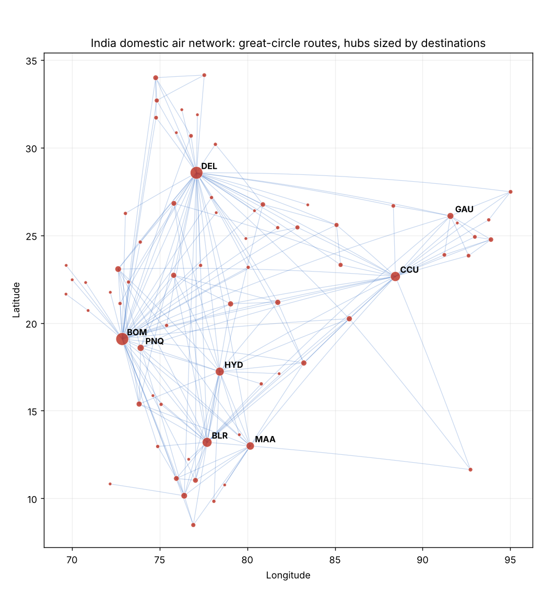
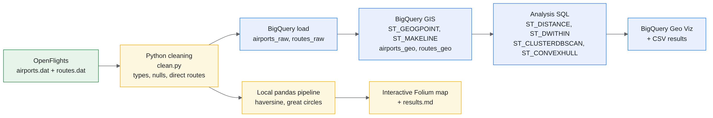
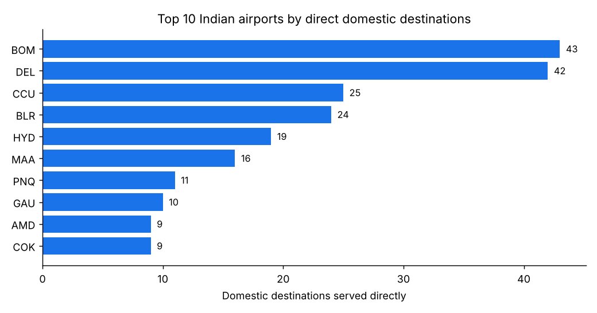
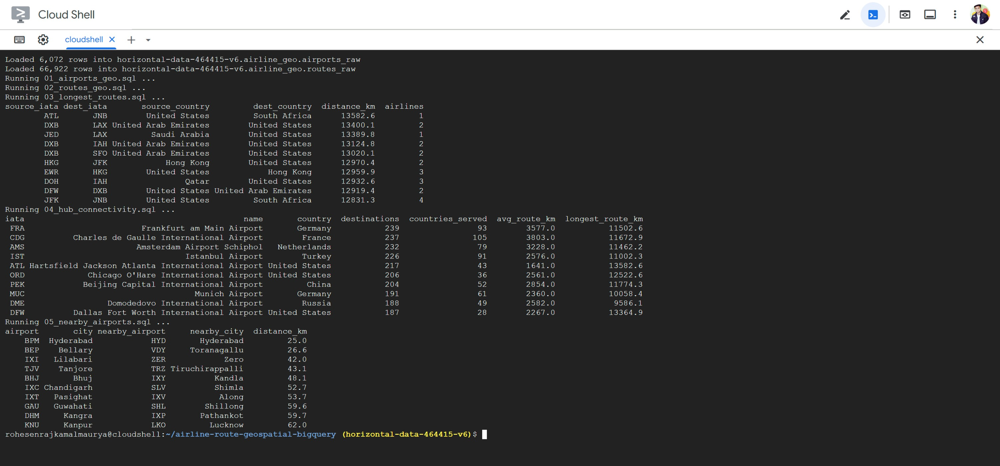
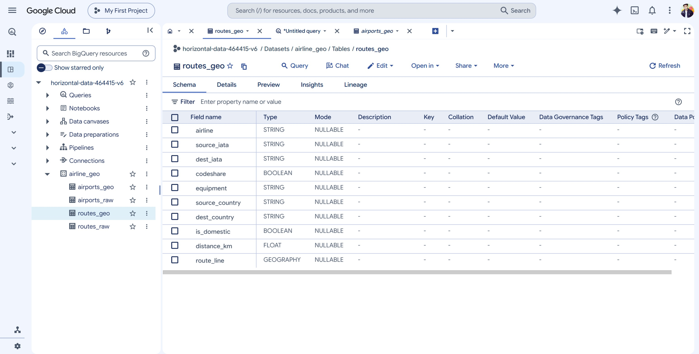
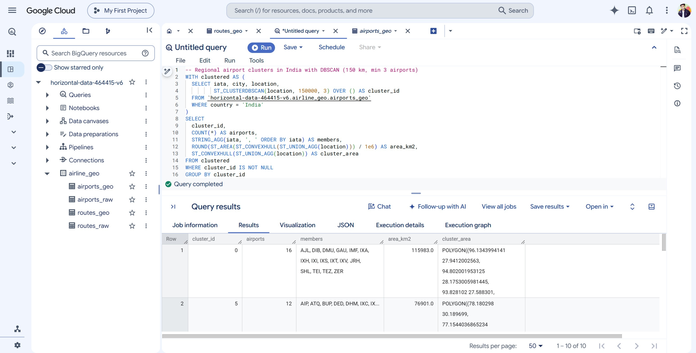
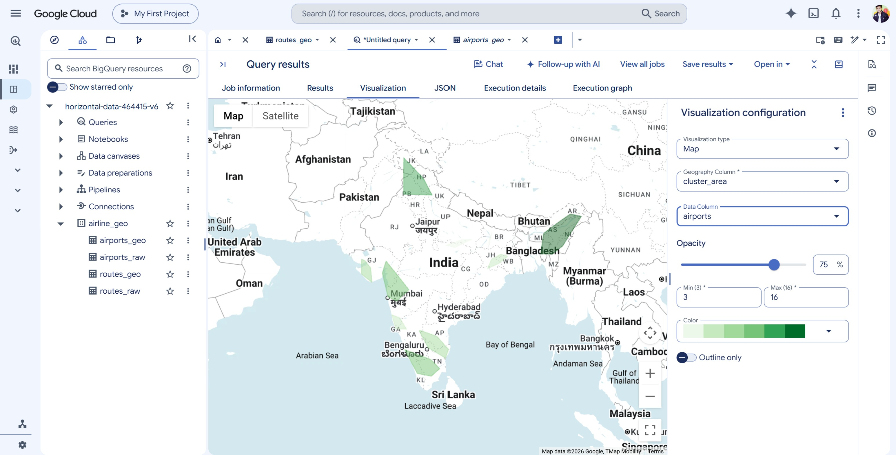
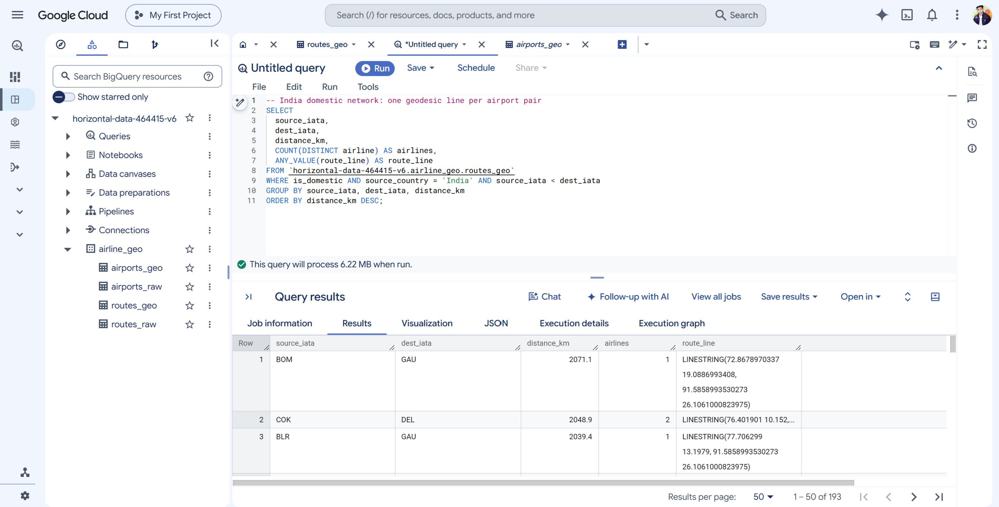
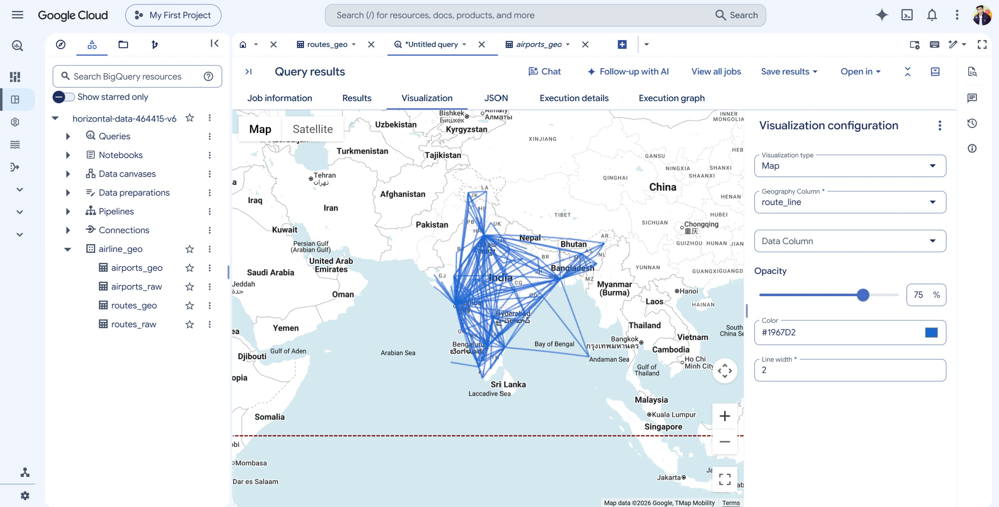

# Airline Route Geospatial Analytics with BigQuery GIS

[](https://github.com/Rohesen/airline-route-geospatial-bigquery/actions/workflows/tests.yml)


A geospatial data pipeline that turns **6,072 airports and 66,922 airline routes** into map-ready insights with **BigQuery GIS**: great-circle distances, hub rankings, nearby-airport detection and regional airport clusters, with India's domestic network as the case study.



**[Open the interactive map](https://rohesen.github.io/airline-route-geospatial-bigquery/india_routes_map.html)**: hover over any route or airport for details.

---

## What it does

| Question | How it is answered | BigQuery GIS |
|---|---|---|
| Where is every airport? | Latitude/longitude become a `GEOGRAPHY` point | `ST_GEOGPOINT` |
| How far is each route? | Great-circle distance on the Earth's surface | `ST_DISTANCE` |
| What does the route look like on a map? | A geodesic line between the two airports | `ST_MAKELINE` |
| Which airports compete for the same passengers? | Spatial join: airports within 100 km of each other | `ST_DWITHIN` |
| Where are the regional airport clusters? | Density-based clustering of airport locations | `ST_CLUSTERDBSCAN` |
| What area does each cluster cover? | Centre point and enclosing polygon per cluster | `ST_CENTROID_AGG`, `ST_CONVEXHULL`, `ST_AREA` |
| Where can I fly from Delhi within 3,000 km? | Route lookup filtered by distance | `ST_DWITHIN` |

## Architecture



1. **Ingest:** `scripts/download_data.py` pulls the OpenFlights airports and routes files.
2. **Clean:** `clean.py` parses the header-less files, converts `\N` to nulls, keeps real airports with valid coordinates and IATA codes, and keeps only direct, de-duplicated routes between known airports.
3. **Load:** `bigquery_pipeline.py` creates the dataset and loads both tables with an explicit schema.
4. **Model:** SQL builds `airports_geo` (a `GEOGRAPHY` point per airport) and `routes_geo` (distance, domestic flag and route line per route), clustered by country.
5. **Analyse:** six analysis queries run in order and save their results as CSV; the geography columns can be drawn directly in **BigQuery Geo Viz**.
6. **Verify locally:** a pandas pipeline repeats the analyses with the haversine formula, so the BigQuery numbers can be checked without a cloud account.

## Key findings

India's domestic network (OpenFlights data) is built around two mega-hubs:



- **Mumbai (BOM, 43 destinations) and Delhi (DEL, 42)** serve nearly twice as many domestic airports as the next hubs, Kolkata (25) and Bengaluru (24).
- **75% of domestic routes are under 1,000 km**; only 8% are longer than 1,500 km, which is why short-haul narrow-body aircraft dominate Indian aviation.

| Distance band | Routes | Share |
|---|---|---|
| under 500 km | 77 | 39.9% |
| 500–1,000 km | 67 | 34.7% |
| 1,000–1,500 km | 33 | 17.1% |
| over 1,500 km | 16 | 8.3% |

- **Overlapping catchments:** 48 pairs of Indian airports sit within 100 km of each other, such as Hyderabad's old and new airports (25 km), Thanjavur–Tiruchirappalli (43 km) and Kanpur–Lucknow (62 km).
- **Regional clusters:** DBSCAN (150 km radius, at least 3 airports) finds 10 airport clusters in India. The largest is the Northeast, with 16 airports across about 116,000 km², followed by the north-western belt from Srinagar to Dehradun (12) and the far south across Kerala, Tamil Nadu and southern Karnataka (10).
- **Globally**, the longest direct route in the data is Atlanta–Johannesburg at 13,583 km, and Frankfurt is the best-connected airport with 239 direct destinations.

Full tables: [docs/results.md](docs/results.md).

## Running on BigQuery

The full pipeline was run on Google Cloud: data loaded from Cloud Shell, all 8 SQL files executed, and the results matched the local pandas run exactly. Every query processed under 5 MB, well inside BigQuery's free tier.

**Pipeline run in Cloud Shell:** both tables loaded, then every SQL file executed in order.



**The `airline_geo` dataset:** `routes_geo` stores each route's distance and its `route_line` as a `GEOGRAPHY` column.



**DBSCAN clustering with `ST_CLUSTERDBSCAN`,** returning each cluster's member airports, area and enclosing polygon:



**The clusters on a map,** shaded by number of airports, in BigQuery's built-in visualisation:



**India's 193 domestic routes as geodesic `LINESTRING`s,** built with `ST_MAKELINE`:



**The same routes on the map:** Mumbai and Delhi stand out as the two hubs most routes fan out from.



## Example query

Regional airport clusters in India, with the centre and enclosing area of each cluster:

```sql
WITH clustered AS (
  SELECT iata, location,
         ST_CLUSTERDBSCAN(location, 150000, 3) OVER () AS cluster_id  -- 150 km, min 3 airports
  FROM `project.airline_geo.airports_geo`
  WHERE country = 'India'
)
SELECT cluster_id,
       COUNT(*) AS airports,
       STRING_AGG(iata, ', ' ORDER BY iata) AS members,
       ST_CENTROID_AGG(location) AS cluster_centre,
       ST_CONVEXHULL(ST_UNION_AGG(location)) AS cluster_area
FROM clustered
WHERE cluster_id IS NOT NULL
GROUP BY cluster_id
ORDER BY airports DESC;
```

All queries are in [`sql/`](sql), numbered in the order they run.

## Run it

### 1. Local (no cloud account needed)

```bash
git clone https://github.com/Rohesen/airline-route-geospatial-bigquery.git
cd airline-route-geospatial-bigquery
pip install -r requirements.txt

python scripts/download_data.py
PYTHONPATH=src python -m geo_routes.local_pipeline   # writes docs/results.md and the maps
pytest -q
```

On Windows PowerShell, set the path with `$env:PYTHONPATH="src"` first.

### 2. BigQuery (free sandbox works)

```bash
gcloud auth application-default login
PYTHONPATH=src python -m geo_routes.bigquery_pipeline --project YOUR_PROJECT_ID
```

This creates the `airline_geo` dataset, loads both tables, builds the geography tables, runs every analysis query and saves the results to `docs/bigquery_results/`.

To see the routes on a map, run `sql/07_india_domestic_network.sql` in the BigQuery console, open **Explore data → Geo Viz** (or the built-in map tab), and choose `route_line` as the geometry column.

## Project structure

```
airline-route-geospatial-bigquery/
├── scripts/download_data.py        # fetch OpenFlights data
├── src/geo_routes/
│   ├── clean.py                    # parse and clean raw files
│   ├── geo.py                      # haversine distance, great-circle paths
│   ├── bigquery_pipeline.py        # load to BigQuery and run the SQL
│   └── local_pipeline.py           # same analyses in pandas, maps, results
├── sql/                            # BigQuery GIS queries, run in order
│   ├── 01_airports_geo.sql
│   ├── 02_routes_geo.sql
│   ├── 03_longest_routes.sql
│   ├── 04_hub_connectivity.sql
│   ├── 05_nearby_airports.sql
│   ├── 06_airport_clusters.sql
│   ├── 07_india_domestic_network.sql
│   └── 08_reach_from_delhi.sql
├── tests/                          # pytest: distances, cleaning, spatial join
└── docs/                           # maps, charts and results
```

## Testing

Distances are checked against published values (Delhi–Mumbai ≈ 1,140 km, London–New York ≈ 5,540 km), along with symmetry, great-circle path shape, the cleaning rules and the nearby-airport join. GitHub Actions runs the tests on Python 3.10 to 3.13.

## Data and limitations

- Airports and routes come from [OpenFlights](https://openflights.org/data), released under the [Open Database License](https://opendatacommons.org/licenses/odbl/1-0/).
- The OpenFlights route table is a **2014 snapshot** and is no longer updated, so it shows the shape of the network rather than today's schedules; newer airports such as Navi Mumbai or Noida are not in it.
- Distances are great-circle distances between airports, not actual flown distances.

## License

MIT © Rohesen Rajkamal Maurya
